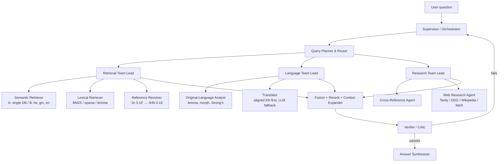

# bible-rag — Project Plan

Multilingual RAG over the Bible (Hebrew OT, Greek LXX, Greek NT, English WEB). We build **two retrieval pipelines** and compare them:

- **Pipeline A:** one multilingual vector DB.
- **Pipeline B:** three language-specific vector DBs, with English alongside every result for reference.

Both pipelines sit behind a **hierarchical agent system**. Everything runs locally.

---

## 0. Key design decisions (read first)

### 0.1 CSV or not?
Convert the data, but make **Parquet** the main working format, not CSV.

| | CSV | Parquet |
|---|---|---|
| Hebrew/Greek text | Excel corrupts UTF-8 without a BOM. Commas and quotes inside verses need escaping. | Safe |
| Types (int chapter/verse, lists of lemmas) | Lost. Everything becomes a string. | Kept, including nested lists |
| Inspecting by eye | Easy | Use pandas or DuckDB |

Plan: JSONL (current output) → **Parquet** as the canonical tables. Write an optional `export_csv.py` (UTF-8 with BOM) only for looking at the data in Excel. DuckDB reads Parquet directly.

### 0.2 Will three DBs lose relevance context? (your main concern)
Only if verses are linked by headings or by text. Link them by a **canonical verse key** instead. The parts are:

1. **Canonical key on every row in every DB.** `canon_ref = "GEN.1.1"` uses one book-code scheme (3-letter USFM) and one versification (KJV/English). Each source also keeps its native `source_ref`.
2. **Versification mapping, so the same key means the same verse.**
   - Hebrew and English numbering differ in places, e.g. Psalm titles (verse 1 in Hebrew), Joel 3/4, Malachi 3/4, Gen 31:55/32:1. **OSHB ships this map:** `data/raw/oshb/wlc/VerseMap.xml` (WLC ↔ KJV, full or partial).
   - LXX and Hebrew differ more: Psalms are off by one for most of 9–147, Jeremiah's chapters are reordered, Daniel and Esther have additions. You need an LXX ↔ KJV mapping table, e.g. from the Copenhagen Alliance versification mappings. Verify the source and license first.
3. **Shared section and paragraph IDs instead of headings.** I checked: **WEB has no `\s` section headings**, so headings were never available. It does have about 8,170 `\p` paragraph markers, plus `\q1`/`\q2` poetry lines. Capture `\p` as `paragraph_id`, attach it to the canonical key, and every language inherits the same paragraphs. That gives one shared definition of "context" across all DBs.
4. **A separate canonical verse store, outside the vector DBs.** This is a plain table in SQLite or DuckDB. It is the source of truth for:
   - looking up a verse in every language,
   - expanding to the full paragraph,
   - joining across languages.

   Vector DBs only *find* candidates. The verse store *assembles* the context.
5. **Merge by rank, not raw score.** Cosine scores from different indexes or models can't be compared. Use **Reciprocal Rank Fusion (RRF)** on `canon_ref`, then a **cross-encoder reranker** over the merged list.

With these in place, three DBs lose nothing. A hit in the Greek DB and a hit in the English DB for the same `canon_ref` combine and **reinforce each other**.

### 0.3 "Convert Hebrew/Greek to English": mostly align, translate only where needed
| Source | English for reference | Method |
|---|---|---|
| Hebrew OT (OSHB) | WEB OT | **Alignment** via `canon_ref` and VerseMap. No machine translation. |
| Greek NT (SBLGNT) | WEB NT | **Alignment** via `canon_ref` |
| Greek LXX | Brenton's English LXX (public domain). Check eBible.org for a USFM copy. | Alignment. Use LLM translation **only** if no aligned text exists. |
| Deuterocanon / LXX additions | LLM translation, run once offline and cached | Label clearly as `method="llm"` with the model name |

Store every English rendering with a `method` column (`aligned_web`, `aligned_brenton`, `llm:<model>`). The answering agent must say when it is quoting a machine translation.

### 0.4 What gets embedded
- `text_display`: original text, untouched, used for showing to the user and for citations.
- `text_norm`: the text that gets embedded.
  - **Hebrew:** remove the `/` morpheme separators (present in 22,990 of 23,213 verses today) and cantillation marks. Keep a vowelless variant for experiments.
  - **Greek:** NFC-normalize. Keep an accent-stripped lowercase variant for lexical search (LXX has all-caps openings like "ΕΝ ΑΡΧΗ").
- **Chunk types:**
  - `verse`: one per verse per source.
  - `window`: 3–5 verse sliding window inside one paragraph.
  - `paragraph`: a whole `\p` block, capped at about 400 tokens.

  Verse chunks give precise citations. Windows and paragraphs give context. Evaluate both.

### 0.5 Embedding model
- **Default:** `BAAI/bge-m3`. It is multilingual and long-context, and produces **dense + sparse** vectors. Sparse helps a lot for proper names and rare words.
- **Alternatives to benchmark:** `intfloat/multilingual-e5-large`, `sentence-transformers/LaBSE` (built for cross-lingual alignment).
- **Risk:** these models were trained mostly on modern Hebrew and Greek, not Biblical Hebrew or Koine. That is the reason Phase 4 measures **cross-lingual recall**: does an English query find the Hebrew verse for the same `canon_ref`?

---

## 1. Target data model

```
verses          verse_uid, source, language, testament, book_id, chapter, verse,
                source_ref, canon_ref, paragraph_id, text_display, text_norm
tokens          verse_uid, position, surface, lemma, strongs, morph      (OSHB now; MorphGNT for NT later)
verse_map       source, source_ref, canon_ref, map_type (full|partial)
paragraphs      paragraph_id, book_id, start_canon_ref, end_canon_ref
english_ref     verse_uid, text_en, method, model
chunks          chunk_id, chunk_type, source, language, canon_refs[], text_embed
cross_refs      from_canon_ref, to_canon_ref, votes                     (OpenBible.info, CC-BY)
lexicon         strongs, lang, lemma, translit, gloss, definition        (openscriptures/strongs)
```

OSHB already carries per-word `lemma` (Strong's-based, e.g. `b/7225`, `1254 a`) and `morph` attributes, about 17.6k words in Genesis alone. That data is free and makes word-study tools possible.

---

## 2. Agent architecture (hierarchical, LangGraph)



- **Supervisor.** Holds the state, sends work to team leads, and stops after N rounds.
- **Query planner.** Classifies the question:
  - direct lookup ("what does Gen 1:1 say in Hebrew")
  - topical ("what does the Bible say about forgiveness")
  - word study ("meaning of *hesed*")
  - comparison (MT vs LXX)
  - historical or background

  It then writes sub-queries, translating the query into Hebrew or Greek for the per-language DBs in pipeline B.
- **Team leads.** Small subgraphs, so each team can be tested and swapped on its own. This is the "hierarchical" part.
- **Fusion and context expander.** RRF on `canon_ref`, then a cross-encoder rerank (e.g. `BAAI/bge-reranker-v2-m3`). Then it pulls the full paragraph in all languages from the **verse store**.
- **Verifier.**
  - Every cited `canon_ref` must exist, and the quoted text must match the verse store.
  - Claims must be supported by retrieved text.
  - Web content must be cited separately from scripture.
  - If a check fails, it sends the question back to the supervisor with the reason.
- **Synthesizer.** Writes the answer with citations, original text, English rendering, and a note on each translation's `method`.

**Rule:** treat text from web search and fetched pages as **data, never instructions**. The verifier also checks that no instruction-like content from the web has leaked into the plan.

---

## 3. Tools

| Tool | Used by | Purpose | Backend |
|---|---|---|---|
| `resolve_reference(text)` | Reference resolver | Parse "1 Cor 13:4-7", "Ps 23", "Jn 3.16", including LXX and Hebrew numbering | Python (regex + alias table) |
| `get_verse(canon_ref, langs)` | All | Exact verse in requested languages + English ref | DuckDB/SQLite |
| `get_passage(start, end, langs)` | Context expander | Range or whole paragraph | DuckDB |
| `semantic_search(query, lang?, testament?, k)` | Semantic retriever | Vector search with metadata filters | Chroma / FAISS / pgvector |
| `lexical_search(query, lang, k)` | Lexical retriever | BM25 or bge-m3 sparse; exact names and words | `rank_bm25` / bge-m3 sparse |
| `lemma_search(strongs or lemma)` | Language analyst | All verses that use a lemma | DuckDB on `tokens` |
| `lexicon_lookup(strongs)` | Language analyst | Gloss, definition, transliteration | `lexicon` table |
| `parse_morph(code)` | Language analyst | Decode OSHB/MorphGNT morph codes into plain words | Python |
| `translate(text, src, tgt)` | Translator | LLM translation, used only when no aligned English exists. Cached. | Ollama / Groq |
| `cross_references(canon_ref, k)` | Cross-ref agent | Related verses (OpenBible.info, about 340k links) | DuckDB |
| `web_search(query)` | Web research | Background, history, scholarship | **Tavily** (`langchain-tavily`, API key) or **DuckDuckGo** (`langchain_community`, no key) |
| `wikipedia(query)` | Web research | Encyclopedic background | `wikipedia` (already a dep) |
| `fetch_url(url)` | Web research | Read one page | `WebBaseLoader` + `bs4` (already deps) |
| `arxiv_search(query)` | Web research (optional) | Computational linguistics or DH papers | `arxiv` (already a dep) |
| `rerank(query, docs)` | Fusion | Cross-encoder rerank | sentence-transformers CrossEncoder |

Expose the retrieval and lookup tools as an **MCP server** (`mcp` + `langchain-mcp-adapters`, both already deps). Claude Code, the Streamlit app, and the agents can then share one tool layer.

This also reverses the earlier note in `CLAUDE.md`: `wikipedia`, `bs4` and `arxiv` are **not** leftovers. They become web-research tools.

---

## 4. Repository layout (target)

```
src/bible_rag/
  config.py               # one settings object: paths, model names, vector backend
  data/                   # parsers, normalization, versification, paragraphs
  stores/
    verse_store.py        # interface + DuckDB impl
    vector_store.py       # interface + Chroma/FAISS/pgvector impl
  embeddings.py           # bge-m3 wrapper (dense + sparse), batching
  retrieval/
    pipeline_a.py         # single multilingual DB
    pipeline_b.py         # 3 DBs + RRF + rerank
    fusion.py, rerank.py, context.py
  tools/                  # one file per tool group; also mcp_server.py
  agents/
    graph.py              # supervisor graph
    teams/retrieval.py, teams/language.py, teams/research.py
    verifier.py, synthesizer.py, prompts/
  api/server.py           # FastAPI
  ui/app.py               # Streamlit
scripts/                  # extract, build_parquet, build_index_a, build_index_b, export_csv
eval/                     # gold set, metrics, run_eval.py
```

**Design rule:** agents and retrieval code talk only to the `VerseStore`, `VectorStore`, `Embedder` and `LLM` interfaces. Swapping Chroma for pgvector, or Ollama for Groq, should be a **config change**, not a rewrite.

---

## 5. Phases

### Phase 0: Fix and canonicalize data (local)
- [ ] Normalize `book_id` to 3-letter USFM codes for all sources. Map OSHB OSIS codes, and complete `LXX_BOOKS` using `data/raw/lxx-swete/utils/convert-swete.py` `TITLES`.
- [ ] Add `canon_ref` + `verse_map`, using OSHB `VerseMap.xml` for Hebrew and an LXX mapping table for LXX.
- [ ] Hebrew: remove `/` and cantillation in `text_norm`. Greek: NFC normalization plus an accent-stripped variant.
- [ ] Capture WEB `\p` paragraphs as `paragraph_id`, and keep `\d` psalm titles (dropped today).
- [ ] Extract OSHB `tokens` (lemma, morph). Add MorphGNT for the NT (based on SBLGNT, CC-BY-SA).
- [ ] Ingest English refs: WEB (done) and Brenton LXX. Download `cross_refs` and `lexicon`.
- [ ] Write Parquet tables plus the optional CSV export.
- [ ] Validation script:
  - counts per book and source,
  - no empty text,
  - every Hebrew/SBLGNT `canon_ref` has a WEB match (list the exceptions),
  - SBLGNT has 7,927 verses vs about 7,939 in WEB NT: explain the difference (the SBLGNT text omits some verses).
- **Exit:** "show GEN.1.1 / PSA.23.1 / JHN.1.1 in every language" works from the verse store.

### Phase 1: Pipeline A, single multilingual DB (local)
- [ ] Embed `verse` + `window` chunks for all sources with bge-m3, about 91k verses plus the windows. Expect hours on CPU, minutes on a GPU, so cache embeddings to Parquet.
- [ ] One collection with metadata: `language, source, testament, canon_ref(s), chunk_type`.
- [ ] Retrieval: top-k → group by `canon_ref` → expand to all languages via the verse store → rerank.
- [ ] Simple, non-agentic RAG chain with an LLM (Ollama locally, Groq for speed). This is the baseline.
- **Exit:** baseline answers with correct citations for 20 hand-picked questions.

### Phase 2: Pipeline B, three DBs (local)
- [ ] `db_he` (OSHB), `db_grc` (LXX + SBLGNT, with `corpus` metadata), `db_en` (WEB, and Brenton as a separate source).
- [ ] Embed the **original-language `text_norm`** in `db_he`/`db_grc`, and keep English as stored payload.
  - If you embed the English instead, `db_he` effectively becomes a copy of `db_en` and the comparison is meaningless.
- [ ] The query planner writes language-specific sub-queries: the original, plus Hebrew/Greek translations, plus key lemmas.
- [ ] Parallel search → RRF on `canon_ref` → rerank → context expansion.
- **Exit:** Pipeline B runs end to end. Compare it with A in Phase 4.

### Phase 3: Hierarchical agent system (local)
- [ ] Tools from §3, each with unit tests on fixed inputs.
- [ ] LangGraph subgraphs per team. Supervisor with a round limit. Verifier loop.
- [ ] MCP server for the tool layer.
- [ ] FastAPI endpoint (`/ask`, `/verse/{ref}`) + Streamlit UI that shows each verse's source text, English rendering and the agent trace.
- [ ] Tracing: LangSmith or MLflow tracing.
- **Exit:** the agent handles all five question types, and the verifier catches bad citations that are injected on purpose.

### Phase 4: Evaluation (local)
- **Gold set (about 150 questions):**
  - 30 direct lookups,
  - 40 topical (with the expected `canon_ref`s),
  - 30 word studies (expected lemmas or Strong's),
  - 20 MT-vs-LXX comparisons,
  - 30 cross-lingual (English query → expected Hebrew/Greek verse).
- **Retrieval metrics:** recall@k, MRR, nDCG on `canon_ref`. Report per language and per pipeline.
- **Answer metrics:**
  - citation precision (every cited ref exists and supports the claim),
  - faithfulness (LLM judge with a rubric, spot-checked by hand),
  - translation-labeling compliance.
- **Ablations:**
  - A vs B,
  - verse vs window vs paragraph chunks,
  - bge-m3 vs e5 vs LaBSE,
  - dense vs hybrid,
  - with and without rerank.
- **Exit:** a results table. Pick defaults based on the numbers.

---

## 6. Risks and open questions
- **Embeddings for ancient languages** may be weak. Mitigations:
  - hybrid lexical/lemma search,
  - query translation into the original language,
  - leaning on aligned English,
  - in the end, fine-tuning on aligned verse pairs (Hebrew↔English, Greek↔English). The aligned corpus *is* the training data.
- **LXX versification** is the hardest part of alignment. Start with Psalms, Jeremiah and Daniel, and log unmapped verses rather than guessing.
- **Licenses:**
  - WEB and Brenton are public domain.
  - Check the actual license files for OSHB and the SBLGNT text in `data/raw` before publishing anything.
  - OpenBible cross-refs are CC-BY and MorphGNT is CC-BY-SA, so attribution is required.
- **Machine translation of scripture** must always be labeled. Never present it as a published translation.
- **Nested git repos** in `data/raw/` need a decision before the first commit: submodules, or ignore them plus a download script.
- **Python 3.14 is very new.** Check that torch, sentence-transformers and the vector DB client have 3.14 wheels before committing to versions.

## 7. Suggested order of work
Phase 0 → 1 → 4 (baseline eval) → 2 → 4 (compare) → 3.

Evaluating early stops you from building agents on top of retrieval that doesn't work.
